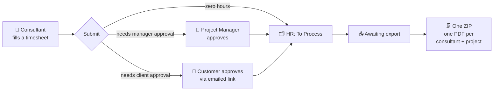
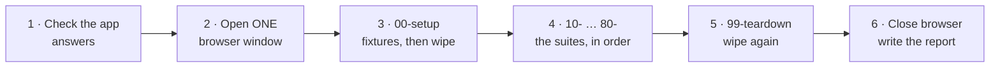

# Titan Time — End-to-End Test Suite

**The automated test script for the Titan Time app.**
It drives a real browser through the real app — logging in, filling a timesheet, approving it,
downloading the export — and reports PASS or FAIL for every step.

---

Think of it as a checklist a robot works through, top to bottom, in about forty minutes.
**This page is that checklist**, written in plain language — no technical background needed.

<table>
<tr><td><b>What it tests</b></td><td>The running Titan Time web app, through a real browser</td></tr>
<tr><td><b>How long</b></td><td>About 40 minutes for all 31 steps</td></tr>
<tr><td><b>What it changes</b></td><td>Only the <code>e2e_*</code> test consultants' data — never real timesheets</td></tr>
<tr><td><b>Where it runs</b></td><td>Your machine, or GitHub, against local / dev / acceptance</td></tr>
<tr><td><b>Who reads this page</b></td><td>Anyone who needs to know what is and isn't covered</td></tr>
</table>

---

## Contents

| | Section | |
|---|---|---|
| 1 | [How a run works](#1-how-a-run-works) | What the conductor does |
| 2 | [**The script, step by step**](#2-the-script-step-by-step) | ⭐ All 31 steps |
| 3 | [Files that aren't part of the run](#3-files-that-arent-part-of-the-run) | Seeders, probes, quality check |
| 4 | [Settings the suite reads](#4-settings-the-suite-reads) | Addresses and logins |
| 5 | [Running it automatically](#5-running-it-automatically-on-github) | The GitHub workflow |
| 6 | [Known traps](#6-known-traps) | Why a PASS can lie |
| 7 | [Glossary](#7-glossary) | Every term used here |

---

## The journey being tested

Most steps below are one stop on this road. It helps to see the whole road first:

---

## 1. How a run works

`run-tests.sh` is the conductor:

1. **Checks the app answers** at the address given — stops immediately if not.
2. **Opens one browser window** and keeps it open for the whole run, so steps inherit each
   other's logged-in session. Deliberate, and it saves a lot of time.
3. **Runs every `verify-*.test.sh` under `suites/`, sorted by path.** The order is load-bearing,
   and the numbered folder names are what carry it:

   | Folder | What runs there |
   |---|---|
   | `00-setup/` | Wipe everything (transactional data *and* projects/assignments), then rebuild the projects/assignments and seed control rows |
   | `10-smoke/` | Sign-in, password reset and the role landing pages |
   | `20-consultant/` | Entering, saving, attaching and submitting time |
   | `30-approval/` | Project manager and customer approval, and resubmitting a rejected line |
   | `40-hr/` | HR sending a week back |
   | `70-tickets/tt683/` | HR processing and the export ZIP and PDFs |
   | `75-export/` | Rejecting after an export has gone out |
   | `80-platform/` | The app's unit-test module, and two cheap checks on the suite itself |
   | `85-security/` | The approval link and who may see or change what |
   | `99-teardown/` | Wipe again |

   Previously this was a flat alphabetical sort, which worked only because `-` sorts before `0`
   — so the fixture step (then named `verify-00-fixtures`) happened to precede
   `verify-000-testdata-clear-before`. The folders make that intent explicit instead of
   incidental.

   Inside `00-setup/` the numbers carry the order, and as of 2026-09-06 it runs
   **clear → build → seed**:

   | Step | What it does |
   |---|---|
   | `verify-000-testdata-clear-before` | Deletes each e2e consultant's transactional data **and** their assignments and the projects those were on |
   | `verify-001-fixtures` | Rebuilds the projects (with their approval flags) and the consultant→project assignments |
   | `verify-002-seed-isolation-control` | Seeds the entry rows `verify-consultant-data-isolation` needs as its control |

   That is the reverse of the old order. The clear used to preserve structure, so the fixture
   step deliberately ran ahead of it; it now removes structure too, so building has to come
   after. The upside is that projects are recreated from `FX_PROJECTS` on every run, which makes
   that table the only source of their approval flags — a project that already exists can no
   longer pass the name check while carrying drifted configuration.
4. **Marks a step FAILED if it exits non-zero**, prints its output, and saves a screenshot named
   `<step>-failure.png` so you can see what the page looked like.
5. **Gives up on a step after 4 minutes**, so one hung page can't stall the run. A step that is
   legitimately longer declares its own budget with a `# tt-timeout: 15m` line anywhere in its
   header comment (the block of `#` lines above the first line of code); `--timeout` overrides
   every declaration. A `tt-timeout` line that has slipped below the header is not read, and the
   runner says so with a `WARN` rather than quietly running the step at the default.
6. **Writes a `results.xml` report** when asked (`--junit`). Nothing consumes it today — CI
   stopped passing `--junit` because no check annotation or dashboard ever read the file, and
   it is written only after the whole run, so a timed-out run produced nothing at all. The
   step log is what people actually read.
7. **Closes the browser** at the end, whatever happened — and on Ctrl-C it stops the run
   instead of carrying on against a session it just closed.
8. **Refuses to start if the number of steps is not what you expected** (`--expect-count N`).
   Without it the run itself cannot fail: rename a step out of the `verify-*.test.sh` pattern
   and the conductor reports "3 steps: 3 passed" and exits happy. CI should always pass it.

> [!NOTE]
> `ci-skip.txt` lists steps to skip on a given environment. It is **empty on purpose** — entries
> get added only when a real run proves a step can't work there, each with a written reason.

---

## 2. The script, step by step

All 31 steps, in the order they run, grouped by the stop on the journey they check.

> [!NOTE]
> **The suite was cut back on 2026-10-30**, from 159 steps to these 31. It had grown by every
> ticket adding its own steps, ran close to three hours, and had not finished green since
> 2026-09-16. What stayed is the journey that pays the bills; per-ticket regressions, sort-order
> and layout checks, read-only probes and the suite's checks on itself were removed, and the rules
> a unit test can hold (hour limits, rollups, who may reject) are left to the model's own unit
> tests. **New steps are added only when Josh asks for one by name.** The removed steps are in
> git history if one is ever wanted back.

The test for keeping a step: *would a failure here mean someone is paid wrong, billed wrong,
locked out, or able to see what they should not?*

### Setup — `00-setup/`

| Step | What it proves |
|---|---|
| `verify-000-testdata-clear-before` | Wipes the e2e consultants' timesheets, assignments and the projects those were on |
| `verify-001-fixtures` | Rebuilds the test projects and assignments through the Titan Manager screens — which also proves assignment creation works |
| `verify-002-seed-isolation-control` | Seeds another consultant's hours, as the control for the privacy check below |

### Signing in — `10-smoke/`

| Step | What it proves |
|---|---|
| `verify-password-reset-redeem` | The whole self-service reset: ask for a link, redeem it from the email, sign in with the new password, and the same link is refused the second time |
| `verify-role-dashboards` | Each role lands on its own dashboard |
| `verify-smoke-login` | Sign-in works |

### Entering and submitting time — `20-consultant/`

| Step | What it proves |
|---|---|
| `verify-consultant-data-isolation` | A consultant cannot read another consultant's hours |
| `verify-consultant-line-items` | On a task-based project, tasks can be added and carry hours |
| `verify-consultant-timesheet-crud` | Hours entered on a draft week are saved and come back on reopen |
| `verify-submit-receipt` | Submit sends each project's hours down the route its approval settings ask for, and the receipt says so truthfully |
| `verify-timesheet-attachment` | A file attached to a week is still there on reopen |
| `verify-timesheet-locks-after-submit` | A submitted week can no longer be edited |

### Approving — `30-approval/`

| Step | What it proves |
|---|---|
| `verify-customer-approval-flow` | The customer opens the emailed link and approves |
| `verify-customer-token-reject` | The customer rejects through the link, with a comment |
| `verify-pm-approve-action` | A project manager approves and the entry leaves their queue |
| `verify-pm-reject-action` | A project manager rejects, and an empty comment is refused |
| `verify-rejected-week-resubmit-mixed` | The consultant fixes the one rejected line and resubmits; the line the PM already approved keeps its approval |

### HR and export — `40-hr/`, `70-tickets/tt683/`, `75-export/`

| Step | What it proves |
|---|---|
| `verify-hr-process-reject` | HR sends a week back from *Weekly to process*, and it leaves the tab |
| `verify-tt683-a0-seed-awaiting-export` | HR processes approved weeks so they are ready to export |
| `verify-tt683-a1-zip-one-pdf-per-assignment` | Export delivers one ZIP holding one PDF per consultant and project |
| `verify-tt683-a3-pdf-body-matches-filename` | Each PDF contains the consultant, project and hours its file name claims |
| `verify-hr-reject-after-export` | An already-exported entry can be rejected, and the hours arithmetic follows it |

`tt683` keeps its ticket folder because the order matters: `75-export` rejects one of the entries
that `tt683` exported.

### Platform — `80-platform/`

| Step | What it proves |
|---|---|
| `verify-fixture-window-expiry` | The test data's hard-coded date window still has room ahead of it, warning before it runs out |
| `verify-run-budget` | The run has exactly the number of steps in `suites/expected-count.txt`, and this README agrees |
| `verify-unittests` | Runs the app's own unit-test module on the target environment and reports each failure |

### Security — `85-security/`

| Step | What it proves |
|---|---|
| `verify-anon-approve-without-token` | Nobody can approve or reject without a valid approval link |
| `verify-anon-token-value-gate` | A link of the right shape but the wrong value is refused |
| `verify-consultant-write-isolation` | A consultant cannot change another consultant's entry, or set their own status |
| `verify-pm-approve-foreign-entry-refused` | A project manager cannot approve an entry waiting on a different project manager |
| `verify-token-replay-refused` | An approval link cannot approve the same week twice |

### Teardown — `99-teardown/`

| Step | What it proves |
|---|---|
| `verify-zzz-testdata-clear-after` | Wipes the test data again |

---

## 3. Files that aren't part of the run

The conductor only picks up files ending in `.test.sh`. Everything else here is run by hand.

| File | What it is |
|---|---|
| `seed-shakedown.sh` | **Run this first, always.** A read-only preflight: is the app up, do the logins work, how slow is a round-trip, and — critically — *which weeks can hold data at all*. Skipping it is how a whole data set once got built on weeks that render no rows. |
| `seed-regression-ladder.sh` | Builds a wide manual-testing data set: entries in every status across many hour scenarios. Destructive, and deliberately not named `.test.sh`. |
| `seed-toprocess-entries.sh` | Narrower ancestor of the above — fills the HR *Weekly To Process* tab by walking real approval chains rather than taking the zero-hour shortcut, so the cards look like genuine timesheets. |
| `verify-toprocess-count.sh` | Reports what is actually on the To Process tab by counting cards, rather than trusting the seeder's own tally. Asserts nothing. |
| `quality/check-app.sh` | Runs Studio Pro's own consistency check from the command line and compares it with a recorded baseline. Exit `0` = no worse than baseline, `1` = new problems. Reads the **last saved** file on disk, so unsaved edits are invisible to it. Marketplace warnings are suppressed so the ones that are ours aren't drowned out. |
| `quality/check-theme.sh` | Lints the two **custom** theme SCSS folders (`theme/web`, `themesource/titan_theme/web`) against `.stylelintrc.json` in the model repo, and compares with `theme-baseline.json`. Covers the half of the app `check-app.sh` cannot see. It is a **ratchet, not a clean desk**: 170 known findings, most parked in `_legacy-rules.scss`, and the gate fails only on NEW ones. Exit `0` = at or below baseline, `1` = regression, `2` = tooling problem. Marketplace themesources are vendor code and out of scope. |
| `tools/mail-selfcheck.sh` | Proves the suite can *read* mail, by opening the app's Emails Sent admin page and reporting what it sees. If this passes but an email step fails, the app did not raise the message — the plumbing is fine. |
| `tools/check-no-echo-trap.sh` | Scans every script for the echo trap (section 6). Runs on every pull request in the *Suite strength* workflow rather than in the nightly, because it reads files, not the app. |
| `lib/*.sh` | Shared building blocks (logging in, resetting data, per-ticket fixtures). Not tests; each header explains the traps it exists to avoid. |

### Reading email

Several steps need to read an email the app just sent. They read it from **the app's own admin
page** — "Emails Sent" on the administrator homepage — which lists every message the app has
produced with its recipient, subject, status and body.

There is nothing to install or configure. This replaced an external mail catcher — a fake SMTP
server — that only ever worked on a laptop: the *app* has to reach a catcher over SMTP, so testing a cloud
environment would have meant a publicly reachable host with an open SMTP port and a secret in
CI. That was the only thing CI needed beyond the app itself, and it was never set up.

Two things the admin page gives that the catcher could not: the recipient is a column, so mail
going to the **wrong address** is detectable; and messages are visible while still *queued*,
before the send event runs, so a step need not wait for delivery to prove a mail was raised.

Freshness comes from a **high-water mark** rather than an emptied inbox — the suite notes which
messages already exist before triggering the action, and only considers newer ones. Nothing is
deleted, so this is safe on a shared environment.

The cost: the page is administrator-only, so reading mail ends whatever role session a step was
using. Details in [`tools/README.md`](tools/README.md).

---

## 4. Settings the suite reads

| Setting | Meaning |
|---|---|
| `TT_BASE_URL` | Which app to test, no trailing slash. Defaults to localhost |
| `TT_ADMIN_USER` / `TT_ADMIN_PASS` | Administrator login |
| `TT_ROLE_PASS` | Password shared by the `e2e_*` role accounts (see below) |
| `TT_E2E_CONSULTANTS` | Which consultants the wipe steps are allowed to clear |
| `TT_E2E_CLEAR_DEPTH` | `deep` (default) also deletes their assignments and the projects those were on; `shallow` is the old transactional-only clear. There is no automatic fallback — against an environment that has not been redeployed with the deep control, the clear fails and names the reason |

**The role accounts.** `e2e_consultant`, `e2e_consultant2`, `e2e_hr`, `e2e_pm`, `e2e_pm2` and
`e2e_tm`, all sharing `TT_ROLE_PASS`. They are **not** created by any fixture — `fx_ensure_*` only
checks they exist and tells you what is missing.

`e2e_pm2` is the second project manager, added so the suite can test that one PM cannot act on
another's work. It deliberately manages **no projects**: the point is that it is *not* the manager
of the E2E project and still must not be able to approve there.

Provisioning one by hand is not obvious, so for the next time: Admin Hub → Accounts Overview → New
local user. Employment status is required (the save is rejected without it). No password is asked
for — one is **autogenerated** and mailed as the *Welcome to the Titan Timesheet App* message, and
the account is flagged to reset on first login. Read that temporary password from **Admin Hub →
Emails Sent**, whose Body columns show it, then log in as the new account once and set the password
to `TT_ROLE_PASS` at the forced-reset prompt.

> [!WARNING]
> In GitHub these come from repository secrets. The defaults built into `lib/_login.sh` are a local
> convenience and **must never be relied on** against a deployed environment.

---

## 5. Running it automatically on GitHub

`.github/workflows/e2e.yml` runs the suite on GitHub's machines:
**Actions → E2E → Run workflow**, optionally typing an app address.

Each run installs the tools and Chromium, runs the suite with the skip list, and uploads any
failure screenshots as downloadable artifacts (kept 30 days). A green run has no screenshots and
so uploads nothing, silently. Only one run happens at a time, because the suite changes shared
data on the target environment.

> [!NOTE]
> The nightly **is live**. The schedule described above as commented-out was switched on once the
> suite reached a clean baseline, and it has since run green end to end (2026-09-16). Two things
> follow that are easy to miss: a nightly writes to shared dev every night whether or not anyone
> is watching, and nothing in GitHub *gates* on it — there is no `pull_request` trigger and no
> branch protection, so a red nightly blocks nothing and only stops mattering when someone looks.

> [!NOTE]
> **When the nightly runs.** The cron is *due* at **20:17 Chicago time** the evening before, not at
> 2am. That is deliberate: since 2026-09-25 GitHub has started every scheduled run 4.5-9 hours late
> (271-532 min over 24 runs, median 392), so a 20:17 cron typically *starts* around **02:00-03:30**
> and finishes before 07:00. A run GitHub delivers more than 10 hours late — one that would start
> after 06:17 and still be wiping test data when people start work — is skipped, with a yellow
> warning and a **SKIPPED** line in the run summary. Run the workflow by hand to test on demand; a
> manual run is never skipped. If GitHub goes back to starting runs on time, the nightly will run at
> about 20:17 — move the cron back toward 02:17 then.

---

## 6. Known traps

> [!WARNING]
> Both traps below produce a **test that passes when it shouldn't** — the worst possible outcome,
> because nobody investigates a green result.

1. **The echo trap.** Asking the browser a question and then searching the raw output for the answer
   can match the *question being echoed back* rather than the answer. Use the decoding helper in
   `lib/_login.sh` instead of searching raw output.
   **Now guarded:** `tools/check-no-echo-trap.sh` fails any pull request that adds a new
   occurrence, with no browser needed.
2. **Assertions that cannot fail.** Treat an unexpected PASS as suspicious until you have broken the
   check on purpose and watched it go red.
   **Now partly guarded:** `--expect-count` stops the *run itself* from passing green when steps
   vanish from discovery. It does not cover an individual weak assertion — that still needs the
   break-it-on-purpose habit.

> [!NOTE]
> Counts go stale fast, so run the guard rather than quoting a number. For the record: an audit on
> 2026-08-24 put the echo trap at roughly 16 sites; commit `f885008` fixed most of them, and a
> mechanical scan the same day found 6 remaining, all since fixed.

A third, softer rule: **never assert on a count you don't own.** Steps assert on the `e2e_*`
consultants' data only, because anything else on a shared environment can change under you.

---

## 7. Glossary

| Term | Meaning here |
|---|---|
| **Step / test** | One `verify-*.test.sh` file — one item on the checklist |
| **Bookend** | The two steps that wipe test data at the start and end of a run |
| **Fixture** | Test data a step needs in place beforehand (a specific project, a rejected entry) |
| **Seed** | To create that data |
| **Consumes** | The step uses up a piece of test data, so it must be recreated for the next run |
| **Idempotent** | The step can be re-run repeatedly without needing a reset |
| **Read-only** | The step looks but changes nothing |
| **Regression guard** | A step that exists to catch one specific bug coming back |
| **Selector** | The label a test uses to find something on screen. This suite uses only names set deliberately in Studio Pro (`.mx-name-*`) — auto-generated ones renumber and break |
| **TT-###** | A Jira ticket number; steps named after one prove that ticket's fix |
